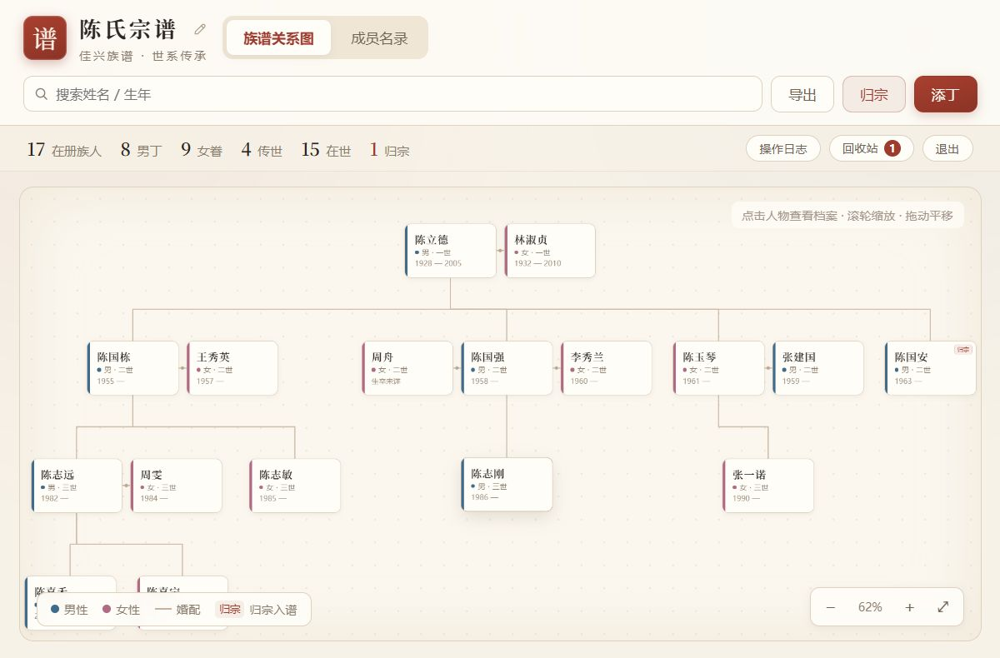
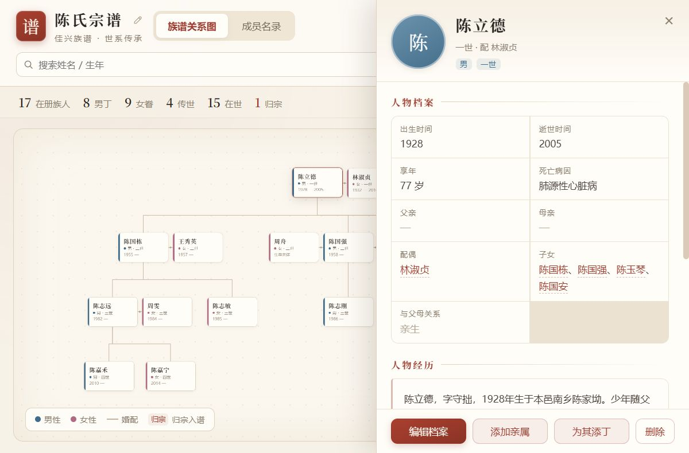
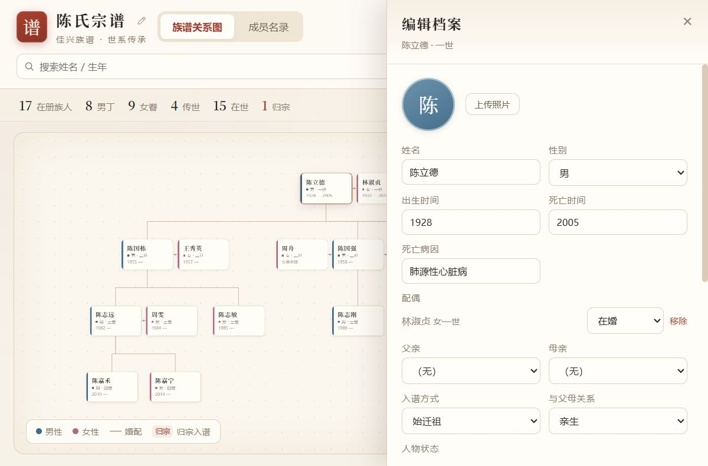

# 佳兴族谱 · 电子族谱 / 宗谱管理系统

> **关键词**：族谱、电子族谱、宗谱、家谱、家族树、世系图、族谱软件、族谱管理系统、家族关系图、GEDCOM、genealogy、family tree、zupu

佳兴族谱是一套可本地部署、开箱即用的中文电子族谱系统。支持多代世系关系图、人物档案、添丁与归宗、配偶与婚姻状态、关系录入校验、操作日志与回收站，以及 PNG / PDF / GEDCOM 导出。数据保存在本地 SQLite 数据库，登录后才能查看，适合家族内部整理与传承。



## 功能特性

### 族谱关系图
- 世系自上而下自动排版，婚配线、亲子线清晰可辨
- 男女用蓝 / 粉双色区分，标注「男 / 女 · 第几世」
- 支持滚轮缩放、拖动平移、一键全览、按姓名搜索定位
- 卡片显示姓名、性别、世代、生卒年；归宗、失考、收养、过继、单亲等状态以小标签提示

### 人物档案
- 点击人物才展开右侧档案，图中只显示必要信息
- 可记录出生时间、死亡时间、死亡病因、人物经历（自由长文本）
- 支持上传人物照片（自动压缩保存）
- 父亲、母亲、配偶、子女均可点击跳转

### 添丁与归宗
- 「添丁入谱」：选择父母后自动排入对应世代
- 「归宗入谱」：记录归宗缘由，卡片带「归宗」标记
- 「添加亲属」：为任意人物添加配偶、父亲、母亲

### 婚姻与亲属状态
- 支持多位配偶（前妻、继室），关系图中并排显示
- 每位配偶可单独标注：在婚、离异、丧偶、再婚
- 亲子关系可标注：亲生、收养、过继
- 人物状态：失考、单亲

### 关系录入防错
- 同名同出生年重复创建会被拦截
- 父母出生必须早于子女；父母不能是自己的后代（防止关系成环）
- 出生晚于死亡、出生 / 死亡晚于今年会被拦截
- 父母与子女年龄差距过小、父母去世后子女出生等情况需二次确认

### 管理与安全
- 账号密码登录，密码 PBKDF2-SHA256 加盐哈希存储
- 未登录时页面不渲染任何族谱内容
- SQLite 本地数据库，增删改自动保存
- 操作日志：记录添丁、归宗、修改、删除、导入导出等操作
- 回收站：删除进入回收站，可还原、彻底删除、清空
- 谱名可自定义（如「陈氏宗谱」「颍川陈氏族谱」）

### 导出与备份
- 导出族谱图片（PNG，2 倍高清）
- 导出族谱 PDF（单页，便于打印存档）
- 导出 GEDCOM 5.5.1（.ged，可导入其他族谱软件）
- 备份 / 恢复 JSON 数据

## 界面预览

| 登录 | 人物档案 |
| --- | --- |
|  |  |

| 编辑档案 | 族谱关系图 |
| --- | --- |
|  |  |

> 截图中的族人为演示数据，首次使用可自行增删改。

## 快速开始

### 方式一：Windows 免安装版（推荐）

1. 在 [Releases](../../releases) 下载 `JiaXingZupu.exe`（佳兴族谱）
2. 把 exe 放到任意文件夹，双击运行
3. 浏览器会自动打开 `http://127.0.0.1:8765`
4. 使用默认账号登录，即可开始建谱

- 绿色免安装，不需要配置 Python 环境
- 数据保存在 exe 同目录的 `data/family.db`，换电脑时连同 `data` 文件夹一起拷贝
- 停止服务：双击 `停止服务.bat`（或重启电脑）

### 方式二：源码运行

环境要求：Python 3.8+（仅使用标准库，无需安装第三方依赖）

```bash
python server.py
```

然后访问 <http://127.0.0.1:8765>。

Windows 也可以直接双击 `启动服务.bat`。

## 默认账号

| 账号 | 密码 |
| --- | --- |
| `admin` | `Admin123456` |

> 首次启动会自动创建默认账号和一份陈氏四世演示族谱，登录后请及时修改数据或按需清空。

## 数据与隐私

- 数据库文件：`data/family.db`（SQLite）
- 服务默认只监听 `127.0.0.1`，仅本机可访问，不会上传任何数据
- 密码使用 PBKDF2-SHA256 加盐哈希，不保存明文
- 登录令牌仅保存在当前标签页，关闭页面后需要重新登录
- 仓库中不包含任何真实家族数据

## 技术栈

- 前端：原生 HTML / CSS / JavaScript，无框架、无构建步骤
- 后端：Python 标准库 `http.server` + `sqlite3`
- 数据库：SQLite
- 图标与界面：纯 CSS 绘制，无外部图片依赖
- 打包：PyInstaller 单文件 exe

## 目录结构

```
.
├── index.html          # 页面结构
├── assets/
│   ├── app.js          # 应用逻辑（关系图、档案、校验、导出）
│   ├── styles.css      # 界面样式
│   └── pdf.js          # 轻量 PDF 生成
├── server.py           # HTTP 服务、登录鉴权、SQLite 读写
├── 启动服务.bat         # Windows 启动脚本（源码方式）
├── 停止服务.bat         # 停止后台服务
├── docs/images/        # README 截图
└── data/               # 运行后生成，数据库与日志（不入库）
```

## 常见问题

**双击 exe 没有反应？**
浏览器可能没有自动弹出，手动访问 <http://127.0.0.1:8765> 即可。

**端口被占用？**
默认端口 8765，可通过环境变量 `PORT` 修改，例如 `set PORT=8800` 后运行 `python server.py`。

**如何换一台电脑使用？**
拷贝 `佳兴族谱.exe` 和 `data` 文件夹到新电脑，双击 exe 即可。

**支持导入其他族谱软件的数据吗？**
目前支持 GEDCOM 导出；如需导入功能，欢迎提交 Issue。

## 参与贡献

欢迎提交 Issue 反馈问题或建议，也欢迎 Fork 后提交 Pull Request。

---

如果这个项目对你有帮助，欢迎点一个 Star ⭐
